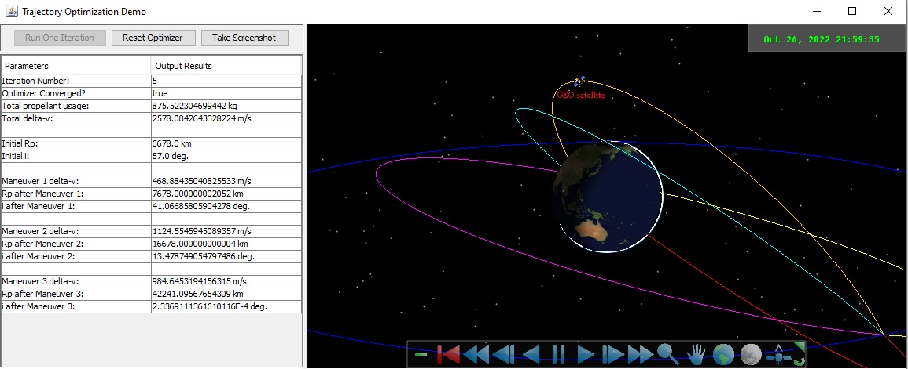

# Trajectory Optimization Demo

This application uses [TargetedSegmentListParameterOptimizer](https://help.agi.com/AGIComponentsJava/Javadoc/agi-foundation-numericalmethods-TargetedSegmentListParameterOptimizer.html) to optimize a GTO to GEO three-maneuver transfer one iteration at a time. The iteration results are then visualized in Insight3D using a [MarkerGraphicsExtension](https://help.agi.com/AGIComponentsJava/Javadoc/agi-foundation-platforms-MarkerGraphicsExtension.html) and a [PathPrimitive](https://help.agi.com/AGIComponentsJava/Javadoc/agi-foundation-graphics-PathPrimitive.html). The optimizer converges after 9 iterations, and it can be reset to its initial state using the Reset Optimizer button. A screenshot of the Insight3D visualization can be copied to the clipboard using the Take Screenshot button.

